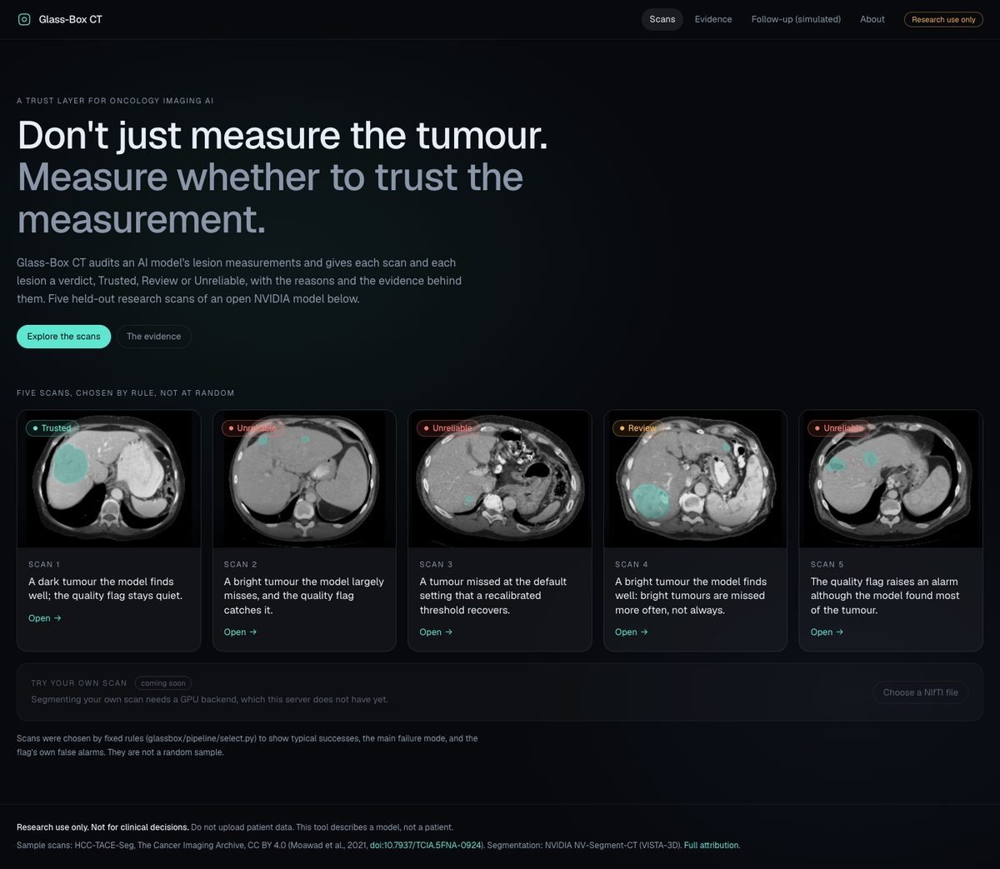
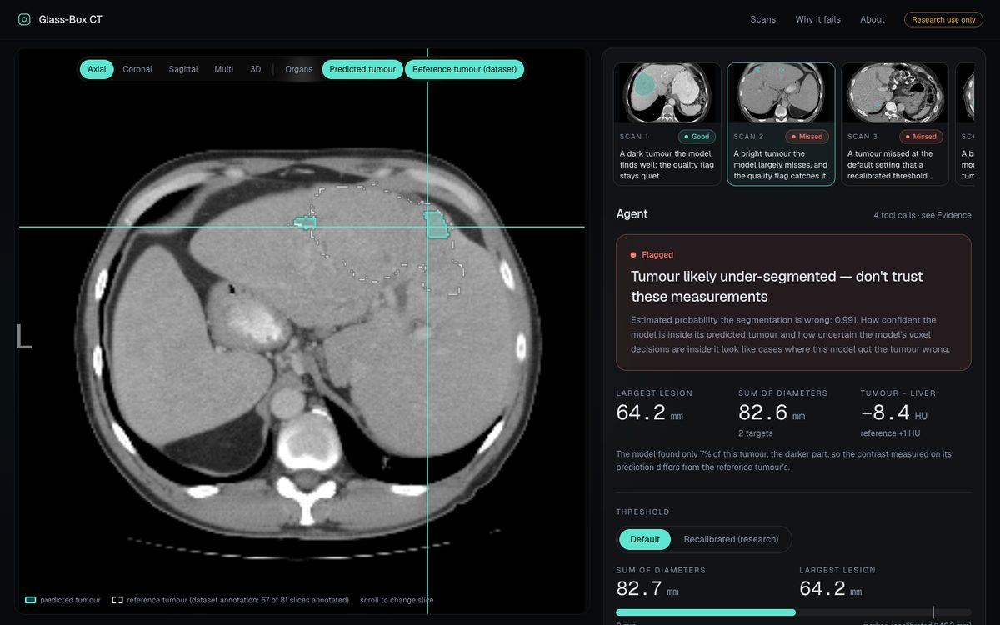
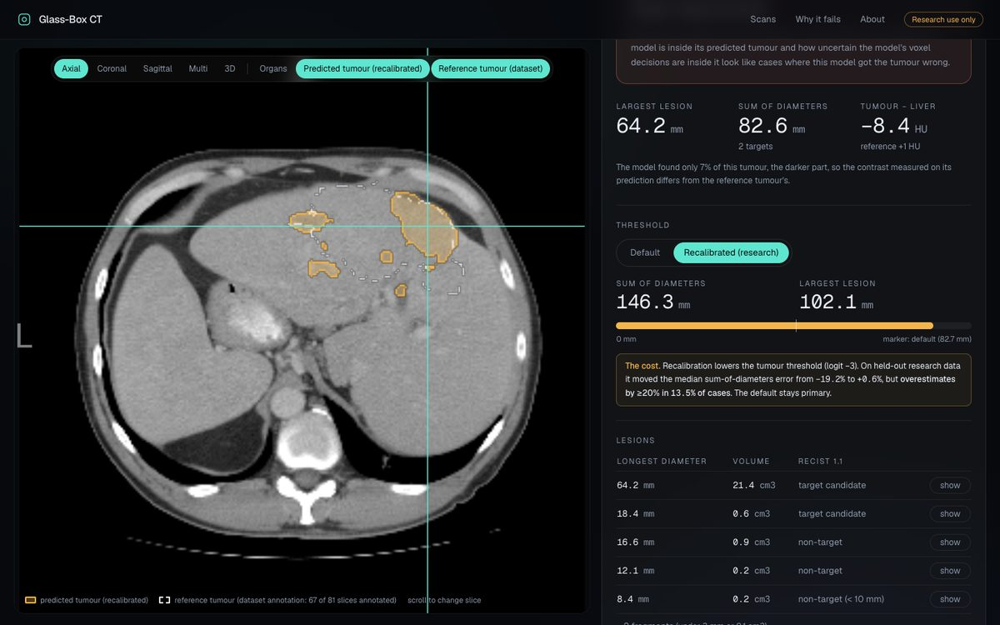
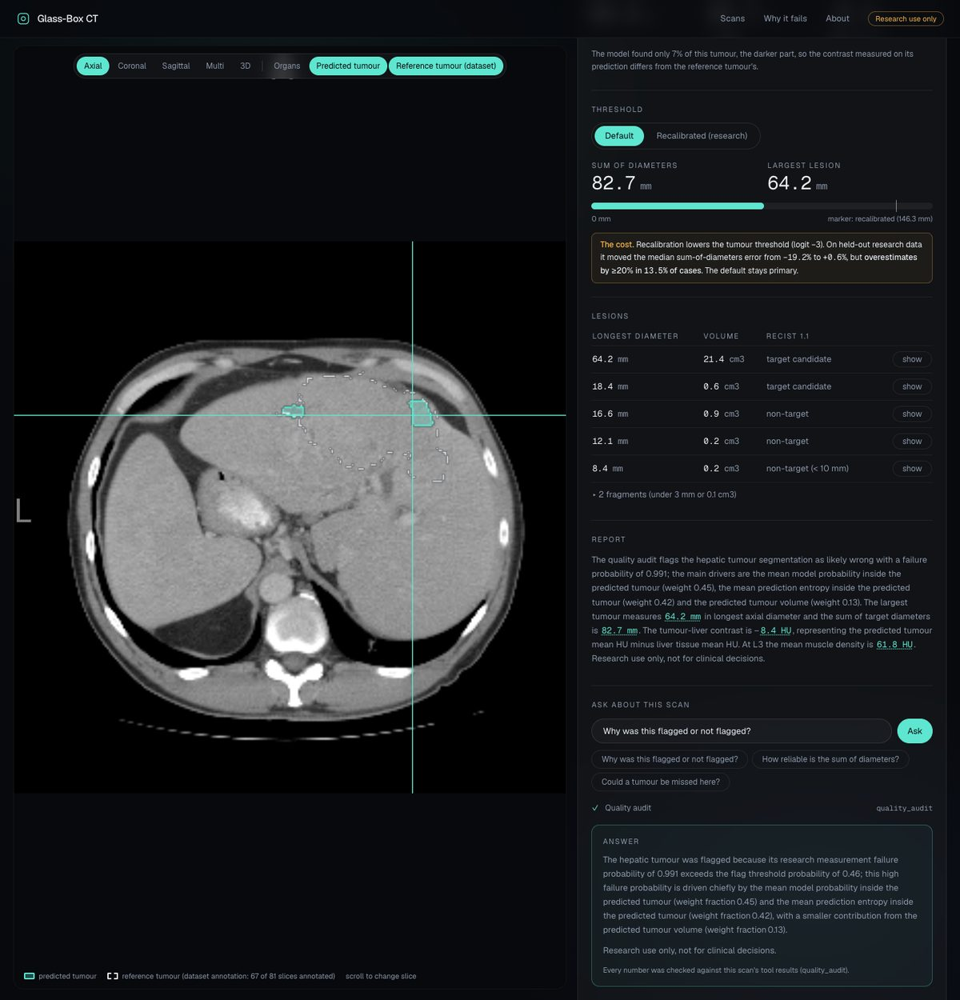

# Glass-Box CT

[](LICENSE) &nbsp; **Research use only. Not for clinical decisions.**

**A trust layer for oncology imaging AI. Don't just measure the tumour; measure whether to trust the measurement.** Glass-Box CT audits an AI model's lesion measurements and gives every scan and every lesion a verdict (**Trusted / Review / Unreliable**) with plain reasons, an audit record you can download, and the evidence behind each warning. The demo audits NVIDIA's open NV-Segment-CT (VISTA-3D) on liver tumours: on held-out research scans it under-measures them by about a fifth (sum of diameters, median **-19%**, 95% CI [-28%, -13%], 75 scans) and almost never over-measures. We found why. The model **represents tumours it fails to segment**, its misses depend **causally** on the tumour being **brighter than the liver**, and one threshold recalibration removes most of the bias **at a stated cost** (it over-estimates by 20% or more in 13.5% of cases). Every claim is pre-registered or labelled exploratory in [results/SUMMARY.md](results/SUMMARY.md).

**Live demo:** `[TO ADD: https://... once deployed]` &nbsp;|&nbsp; **Video:** `[TO ADD]`

| | |
|---|---|
|  |  |
|  |  |

## What it does
- **Verdicts.** Each scan and each lesion is Trusted, Review or Unreliable, with reasons that each name the tool result they come from (quality flag, measured tumour-versus-liver contrast, lesion size, fragments). The rules are written down in [glassbox/trust/verdict.py](glassbox/trust/verdict.py) and are a research heuristic about the *measurement*, never a diagnosis.
- **Quality flag.** A logistic flag on the model's own confidence predicts when the tumour segmentation is wrong (cross-validated AUROC 0.925 [0.860, 0.980]).
- **Flag-gated recalibration (a suggestion, not the default).** Default stays the primary measurement. When the quality flag says the segmentation is likely wrong, the app shows a "Trust layer suggestion (research)": the recalibrated measurement, with its caveat and its over-estimation rate beside it. Evidence, honestly: a pre-registered test said recalibrating only when flagged beats both always-default and always-recalibrated (over-estimates by 20% or more in 3.4% of cases); a nested-CV sensitivity analysis, where nothing about the held-out fold touches any threshold, gives 7.9% [3.4%, 14.6%] and does **not** clear the same bar against always-recalibrating (12.4%), though it still cuts the mean absolute sum-of-diameters error from 34.1% to 19.8%. The app and this README quote the more cautious nested numbers. See [results/SUMMARY.md](results/SUMMARY.md) section 7.
- **Measures** the five sample scans (largest lesion, sum of diameters, tumour-minus-liver contrast, muscle at L3) and shows the prediction against the dataset's own reference annotation, with a **recalibrated (research)** threshold next to the default. The default stays primary and the cost is stated beside it.
- **Audit record.** A downloadable JSON and a readable PDF per scan: model and checkpoint hash, thresholds, flag score and reasons, default vs recalibrated values, the agent's report, the tool-call log and an integrity checksum.
- **Two-timepoint check (simulated).** Matches lesions across two scans and computes RECIST 1.1 response under default and recalibrated measurement, and flags when the response category depends on the calibration. There are no usable follow-up pairs in the dataset, so the pairs are **simulated** from a bias model fitted to the real per-lesion measurements, and every screen says so. In a substantial share of simulated scenarios the response call depends on the calibration; the simulation needs one assumption it cannot fit (how much a lesion's misses persist between visits), the page exposes it and shows how the answer changes at 0, 50% and 100%, and the qualitative finding holds across that range (numbers in [results/SUMMARY.md](results/SUMMARY.md)).
- **Agent.** A tool-calling Nemotron agent gathers the tool results and writes a short report; every number is checked against the tool results and must carry its unit (a failing report is rewritten, then replaced by a template, never shown unchecked).
- **Ask about this scan.** Questions go to the agent with that scan's tool results; clinical advice, diagnosis and treatment questions are refused before any model is called.
- **Evidence.** The research behind the warnings, with every number tied to `results/SUMMARY.md` (a test enforces it).

## Quick start
```bash
# Docker (no GPU needed; the five scans and their reports are baked in; data/demo is not in git, see docs/DEPLOY.md)
docker build -t glassbox-ct .
docker run --rm -p 8000:8000 --env-file .env glassbox-ct       # http://localhost:8000

# Without Docker
python -m venv .venv && .venv/bin/pip install -r requirements-serve.txt
(cd frontend && npm ci && npm run build)
cp .env.example .env                                            # fill in the language model; without it reports use a template and "Ask" is off
GLASSBOX_DEMO_DIR=data/demo .venv/bin/uvicorn --factory glassbox.app.main:build_app --port 8000
```
The server logs which provider and model it uses at start-up. Deploying: [docs/DEPLOY.md](docs/DEPLOY.md). Nebius Token Factory setup and where it is called in the code: [docs/TOKEN_FACTORY.md](docs/TOKEN_FACTORY.md).

## How NVIDIA models and Nebius are used
- **NVIDIA NV-Segment-CT (VISTA-3D, `vista3d132`)** is the model under study, used frozen under the NVIDIA Open Model License (weights are not in this repository). All research (probes, erasure, patching, steering) reads or edits its internal activations; the app serves its pre-computed outputs.
- **NVIDIA Nemotron** is the agent's language model: a reasoning model writes the report and Ask answers, a smaller one runs the tool-calling steps. Model IDs: [FILL after `scripts/list_models.py`].
- **Nebius Token Factory** serves those Nemotron models in the submitted build, and it is the only provider the production server accepts (`GLASSBOX_ENV=production` refuses any other host at start-up; no fallback). The calls are in `glassbox/agent/agent.py` (tool loop and report) and `glassbox/agent/ask.py`, through the client built in `glassbox/agent/config.py`. Details: [docs/TOKEN_FACTORY.md](docs/TOKEN_FACTORY.md). The server logs the provider and models at start-up and `/api/health` reports them.
- **Nebius AI Cloud** hosts the container `[TO CONFIRM: deployed on Nebius AI Cloud / which fallback]`. The research ran on a rented A100 elsewhere (Lambda).

## Research summary
Full write-up with cohorts, intervals and a pre-registered / exploratory label for every number: **[results/SUMMARY.md](results/SUMMARY.md)**. Pre-registrations and deviation logs sit beside the results (`results/*/PREREG.md`, `DEVIATIONS.md`) and were committed before the results they govern.

| Question | Finding | Status |
|---|---|---|
| How wrong is the model? | Sum of diameters -19% [-28%, -13%]; detected lesions 11.4 mm too small; about 1 in 5 lesions largely missed | descriptive |
| Is the missed tissue represented? | Mid-encoder read-out finds 0.587 [0.551, 0.656] of it vs 0.079 [0.060, 0.090] untrained, 0.114 [0.050, 0.146] raw brightness: **lost late** | pre-registered |
| Does brightness cause misses? | Making dark tumours bright cuts coverage by 0.208 [0.098, 0.284]; 56 of 62 move as predicted (reverse arm passes narrowly) | pre-registered |
| Is the tumour direction used? | Erasing it: lesion Dice -0.33 [-0.38, -0.29]; random direction -0.002; liver unchanged | pre-registered |
| Where does it arise? | Pasting the dark version's mid-encoder state back inside the tumour restores 0.79 [0.71, 0.85] | pre-registered |
| Can we fix it? | One threshold shift: Dice 0.555 to 0.635, median error -19.2% to +0.6%, but over-estimates by >=20% in 13.5% of cases. Our 48-weight re-fit and steering did **not** beat it | pre-registered |

## Limitations
- One model, one disease (HCC), one public dataset, 89 to 103 scans: nothing here is about patients, outcomes or contrast phase (the phase fields are stripped from the DICOM).
- The recalibrated threshold was chosen on these same cases (cross-validated), and the 13.5% cost was measured with per-fold thresholds, not the single fixed value the app uses (logit -3).
- The bridge and stratified analyses are exploratory; the counterfactual's bright-to-dark arm passes narrowly (CI lower bound +0.001).
- The quality flag is a research signal fitted on 75 held-out scans. A small or absent tumour prediction does not rule out a tumour.

**Disclaimer.** Research use only. Not a medical device. Not for clinical decisions. Do not upload patient data.

## Data attribution (HCC-TACE-Seg, CC BY 4.0)
The sample scans are from the HCC-TACE-Seg collection on The Cancer Imaging Archive (TCIA), licensed CC BY 4.0, shown as research examples. They were resampled for viewing; the segmentations shown are this model's output, not the dataset's annotations (the dashed reference outline is the dataset's own).
- Dataset: Moawad, A. W., Fuentes, D., Morshid, A., Khalaf, A. M., Elmohr, M. M., Abusaif, A., Hazle, J. D., Kaseb, A. O., Hassan, M., Mahvash, A., Szklaruk, J., Qayyom, A., Elsayes, K. (2021). *Multimodality annotated HCC cases with and without advanced imaging segmentation (HCC-TACE-Seg)* [Data set]. The Cancer Imaging Archive. https://doi.org/10.7937/TCIA.5FNA-0924
- Data paper: Moawad, A. W. et al. (2023). Multimodality annotated hepatocellular carcinoma data set including pre- and post-TACE with imaging segmentation. *Scientific Data* 10, 33. https://doi.org/10.1038/s41597-023-01928-3
- TCIA: Clark, K. et al. (2013). The Cancer Imaging Archive (TCIA): maintaining and operating a public information repository. *Journal of Digital Imaging* 26(6), 1045-1057. https://doi.org/10.1007/s10278-013-9622-7

## License
Code: [MIT](LICENSE). NV-Segment-CT weights: NVIDIA Open Model License (not redistributed here). Viewer: NiiVue (BSD-2). Sample data: CC BY 4.0 (above).

## Repository map
`glassbox/` Python package (`agent`, `app`, `pipeline`, `seg`, `extract`, `bodycomp`, `probes`, `quality`, `trust`) &middot; `frontend/` React + Tailwind + Framer Motion app (NiiVue viewer) &middot; `scripts/` experiments, demo build and checks &middot; `results/` pre-registrations, deviations, tables and figures &middot; `tests/` (68 tests, including one that ties every number on the "Evidence" page to `results/SUMMARY.md`) &middot; `docs/` deployment and Token Factory runbooks.

## Gotchas for anyone using NV-Segment-CT (`vista3d132`)

These come from reading the shipped code (quoted with file and line in `results/exp1_audit/AUDIT.md`), not from the paper.
- **"Segment everything" never outputs hepatic tumour.** Tumour and lesion classes (23 lung, 24 pancreatic, 26 hepatic, 27 colon, 128 bone lesion) are excluded from that mode, so an automatic run on a liver CT will show no tumour whether or not one exists. Prompt class 26 explicitly. This repository's tools enforce it (`glassbox/seg/prompts.py`).
- **Classes 129 (kidney mass) and 130 (liver tumour) cannot be prompted by label.** They need point prompts.
- **The foreground threshold is logit > 0 (probability 0.5) for every class**, applied before resampling the label map. There is no tunable threshold in the shipped pipeline.
- **With several classes prompted together, overlaps are resolved by argmax over the class logits**, with no priority order.
- **On held-out HCC CT the tumour class under-measures lesions, always in the same direction.** See `results/` and the write-up before using it for RECIST-style measurements.
