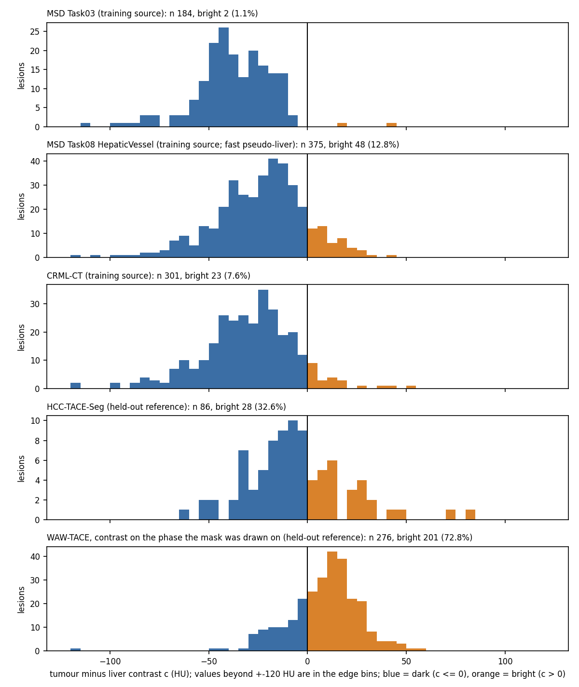

# Bright versus dark tumours in VISTA-3D's liver-tumour training sources (EXPLORATORY / DESCRIPTIVE; 2026-11-15)

Frozen W1 contrast definition (`../PREREG.md`): c = tumour mean HU minus the mean HU of non-tumour liver in the 5 to 20 mm shell around the lesion (200-voxel fallback); bright = c > 0 HU; lesions of at least 10 mm; primary unit = the 2 largest lesions per case; the last column gives all lesions of at least 10 mm. No contrast was recomputed for this table: it reads the per-lesion tables the frozen pipeline already produced (`../msd_lesions.csv`, `../crml_lesions.csv`, `../hcc_lesions_variants.csv`, `../../w4_waw/contrast_masked_phase.csv`, `../../w4_waw/paired_instances/tumours_paired.csv`); script `scripts/w1_source_contrast_table.py`. The Task03, CRML-CT and HCC rows reproduce the W1 results (`../w1_results.md`); bootstrap CIs differ in the first decimal because the resampling code here is separate. Bright-share CIs: case-level bootstrap, 1,000 resamples, seed 0.

## Table

| Dataset | Phase | Cases | Lesions (2 largest per case) | Bright (c > 0) | Dark (c <= 0) | Bright share [95% CI] | c quantiles 5/25/50/75/95 (HU) | All lesions >= 10 mm: bright / total |
|---|---|---|---|---|---|---|---|---|
| MSD Task03 (training source) | portal-venous in most cases (LiTS, several institutions); phase not labelled per case | 113 | 184 | 2 | 182 | 1.1% [0.0, 2.8] | -74, -47, -38, -25, -12 | 3 / 574 |
| MSD Task08 HepaticVessel (training source; fast pseudo-liver) | portal-venous per the MSD description (not verified per case); liver mask = TotalSegmentator --fast pseudo-liver (no liver label in Task08); lesions further than 10 mm from it excluded | 299 | 375 | 48 | 327 | 12.8% [9.6, 16.4] | -65, -38, -21, -9, +12 | 49 / 463 |
| CRML-CT (training source) | portal-venous (preoperative contrast-enhanced CT) | 194 | 301 | 23 | 278 | 7.6% [4.4, 11.2] | -70, -42, -28, -15, +5 | 29 / 408 |
| HCC-TACE-Seg (held-out reference) | mixed acquisitions; phase not labelled (tags stripped) | 75 | 86 | 28 | 58 | 32.6% [22.1, 42.4] | -43, -21, -9, +6, +31 | n/a (primary unit only) |
| WAW-TACE, contrast on the phase the mask was drawn on (held-out reference) | arterial (phase 1) or portal-venous (phase 2), whichever the annotators drew on; 181 of 276 primary lesions drawn on arterial | 199 | 276 | 201 | 75 | 72.8% [66.9, 78.6] | -23, -0, +12, +19, +35 | 245 / 329 |
| WAW-TACE arterial series, all 297 paired tumours | arterial | 181 | 297 | 242 | 55 | 81.5% [75.4, 86.9] | -11, +3, +12, +19, +33 | n/a (primary unit only) |
| WAW-TACE portal-venous series, same 297 tumours | portal-venous | 181 | 297 | 166 | 131 | 55.9% [49.3, 62.4] | -26, -8, +2, +11, +24 | n/a (primary unit only) |

WAW-TACE primary lesions by the phase the mask was drawn on: arterial-drawn: 154/181 bright (85.1%); portal-drawn: 47/95 bright (49.5%)

## Histogram

`source_contrast_histogram.png`: one panel per dataset (primary unit), 5 HU bins, values beyond +-120 HU in the edge bins, blue = dark (c <= 0), orange = bright (c > 0), black line at 0. Per-lesion values: `source_contrast_lesions.csv`; all numbers: `source_contrast_table.json`.

## Phases (as far as known)

- MSD Task03: portal-venous in most cases (LiTS, several institutions); phase not labelled per case.
- CRML-CT: portal-venous (preoperative contrast-enhanced CT).
- MSD Task08: stated portal-venous in the MSD description (not verified per case); not in the table, see below.
- HCC-TACE-Seg: mixed acquisitions; phase not labelled (tags stripped).
- WAW-TACE: arterial and portal-venous pairs; the contrast row uses the phase the annotators drew on (181 of 276 primary lesions on arterial); the two series rows use the same 297 paired tumours on each series.

## MSD Task08 (HepaticVessel): fast pseudo-liver (a DEVIATION; validated first)

Task08 has no liver label, so the liver reference is a TotalSegmentator pseudo-liver (`total` task, class `liver`, CPU, version 2.18.0; largest connected component; tumour voxels removed; lesions entirely further than 10 mm from it excluded: none). The PREREG fixes full resolution, which takes 801 to 873 s per case on this CPU (about 65 h for 303 cases), so the 3 mm `--fast` model (about 20 to 30 s per case) was used on the researcher's decision (`../DEVIATIONS.md`). Every Task08 number is therefore labelled **fast pseudo-liver**.

Validation before the full run (rule fixed before running; `../task08/validation_fast_vs_full.json`): 5 cases drawn with `random.Random(20261115).sample(sorted names, 5)`; liver Dice full against fast 0.970 to 0.978 in every case (minimum 0.9701, rule: each at least 0.95); the 11 lesions of those cases differ in contrast by at most 2.34 HU (median 0.63 HU) and none flips between bright and dark. PASS. Limit: all 11 lesions are dark (the closest to zero is -3.6 HU), so the check does not directly test a bright lesion.

Full run: 303 of 303 cases processed (inventory `../task08/task08_fast_inventory.csv`), 463 lesions of at least 10 mm in 299 cases, 375 in the primary unit; no lesion excluded for distance, no shell fallback needed. Result: **48 of 375 primary lesions bright, 12.8% [9.6, 16.4]** (all lesions: 49 of 463); median contrast -21 HU. Sensitivity (Task08 labels a hepatic vessel class that the pseudo-liver may contain; the PREREG does not remove it): removing the vessel-labelled voxels from the reference gives 50 bright of 375 (`contrast_hu_no_vessel_label` in `../task08/task08_fast_lesions.csv`). Task08 is a secondary analysis and was not part of the W1 verdict.
